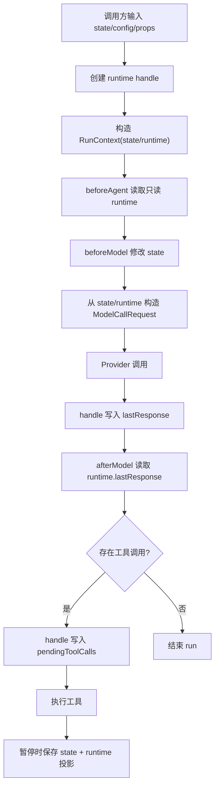

# Agent Loop State/Runtime 设计

> 当前版本说明 Agent Loop 的两层公共 Context、只读 runtime 视图和 checkpoint runtime 投影。本设计取代旧的 `state / props / runtime / loopState` 四层 Context。

## 1. 设计目标

Agent Loop 同时处理持久会话数据、调用方运行参数、框架执行状态和进程内依赖。公共 API 只暴露两个概念：

- `state`：跨多次 run 持久存在的可变会话状态。
- `runtime`：当前执行的只读框架视图，包含 props、执行进度和进程内能力。

框架内部通过私有 runtime handle 修改执行状态，中间件和工具不能直接改写轮次、待执行工具或停止原因。

## 2. 运行入参

```ts
agent.run({
  state,
  config: {
    maxTurns: 20,
    signal: abortController.signal,
  },
  props: {
    cwd: process.cwd(),
    platform: process.platform,
  },
})
```

| 字段     | 语义                   | 是否进入 checkpoint |
| -------- | ---------------------- | ------------------- |
| `state`  | 会话动态状态           | 是                  |
| `config` | 本次调用控制配置       | 否                  |
| `props`  | 本次调用的只读环境信息 | 否                  |

`props` 是运行入参，但中间件和工具统一通过 `ctx.runtime.props` 读取。

## 3. RunContext

```ts
interface RunContext {
  state: AgentState
  readonly runtime: AgentRuntime
}
```

### 3.1 state

`state` 是会话状态的唯一真相。固定字段包括：

- `messages`：完整消息历史。
- `usage`：跨多次 run 累计的 token 用量。

中间件和工具可以扩展顶层字段，例如 `todos`、`shellCwd` 和 `readFileState`。所有需要进入 checkpoint 的扩展状态都必须可序列化。

### 3.2 runtime

`runtime` 是框架创建的只读视图：

```ts
interface AgentRuntime {
  readonly runId: string
  readonly startedAt: number
  readonly props: Readonly<Record<string, unknown>>

  readonly provider: LLMProvider
  readonly system: string
  readonly tools: readonly ToolDefinition[]
  readonly middleware: readonly AgentMiddleware[]
  readonly signal: AbortSignal

  readonly turnIndex: number
  readonly stopReason: AgentStopReason
  readonly lastResponse?: Readonly<ChatResponse>
  readonly pendingToolCalls: readonly Readonly<PendingToolCall>[]

  readonly emitCustomAgentEvent: (event: {
    source: string
    name: string
    payload: JsonValue
  }) => void
}
```

字段按生命周期分为两类：

- 进程内能力：`provider`、`tools`、`middleware`、`signal` 和 `emitCustomAgentEvent`，resume 时重新构建。
- 执行状态：`startedAt`、`turnIndex`、`stopReason`、`lastResponse` 和 `pendingToolCalls`，由框架内部维护。

`runtime.system` 和 `runtime.tools` 是构造模型请求的默认配置。中间件要影响某一次真实模型调用时，应在 `wrapModelCall` 中改写 `ModelCallRequest.params`。

## 4. 内部 Runtime Handle

公共 `AgentRuntime` 不提供写接口。Agent Loop 内部持有一个不导出的 runtime handle：

```ts
interface RuntimeHandle {
  readonly runtime: AgentRuntime
  readonly turnIndex: number
  readonly stopReason: AgentStopReason

  setTurnIndex(turnIndex: number): void
  setStopReason(reason: AgentStopReason): void
  setLastResponse(response: ChatResponse | undefined): void
  setPendingToolCalls(calls: PendingToolCall[]): void
  createCheckpointState(): SerializableRuntimeState
  drainEvents(): CustomAgentEvent[]
  hasEvents(): boolean
  subscribeEvents(listener: () => void): () => void
}
```

`ctx.runtime` 通过 getter 读取 handle 内部状态。runtime 对象和 pending tool calls 视图会冻结，避免中间件或工具绕过类型直接修改框架执行状态。自定义事件队列和监听器也由 handle 私有持有，不进入公共 Context 或 checkpoint。

## 5. Checkpoint

checkpoint 保存持久 state 和 runtime 中恢复所需的显式投影：

```ts
interface SerializableRuntimeState {
  startedAt: number
  turnIndex: number
  pendingToolCalls: PendingToolCall[]
}

interface SessionCheckpoint {
  state: SerializableAgentState
  runtime: SerializableRuntimeState
  reason: string
  payload?: Record<string, unknown>
  suspendedAt: number
}
```

这里不采用“自动保留 runtime 中所有可序列化字段”的策略。能序列化不代表应该恢复：

- resume 会生成新的 `runId`。
- `stopReason` 描述上一次为什么结束，不作为新 run 的初始停止原因。
- `lastResponse` 已经写入 `state.messages`，不重复保存。
- provider、tools、middleware、signal 和 props 由 Agent 配置及 resume 入参重建。

`startedAt` 表示完整执行链的起点，resume 后继续沿用。

## 6. 自定义 Agent 事件

Core 不再比较 `AgentState` 快照，也不推断哪些业务变化需要暴露。中间件在理解自身业务语义的位置调用 `runtime.emitCustomAgentEvent()`，只发送外部消费者需要的可序列化投影：

```ts
interface CustomAgentEvent<TPayload = JsonValue> {
  type: 'custom'
  runId: string
  turnIndex: number
  source: string
  name: string
  payload: TPayload
}
```

`runId` 和 `turnIndex` 由框架在发送时补齐，payload 会在进入队列时复制。Loop 在等待异步 hook、wrapper、stream 和工具执行时持续转发队列，因此 `started` 一类事件可以在对应异步工作完成前被外部观察到。

自定义事件不是状态持久化协议。checkpoint 仍保存完整 `state + runtime` 投影；正常结束时 `agent_run_end.state` 携带最终的完整可序列化 state。业务中间件只应为实时展示、通知或可观测性发送必要字段。

## 7. 执行流程


