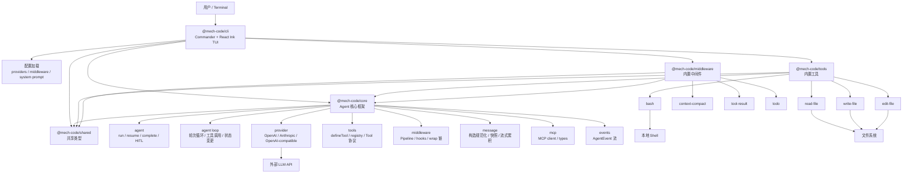
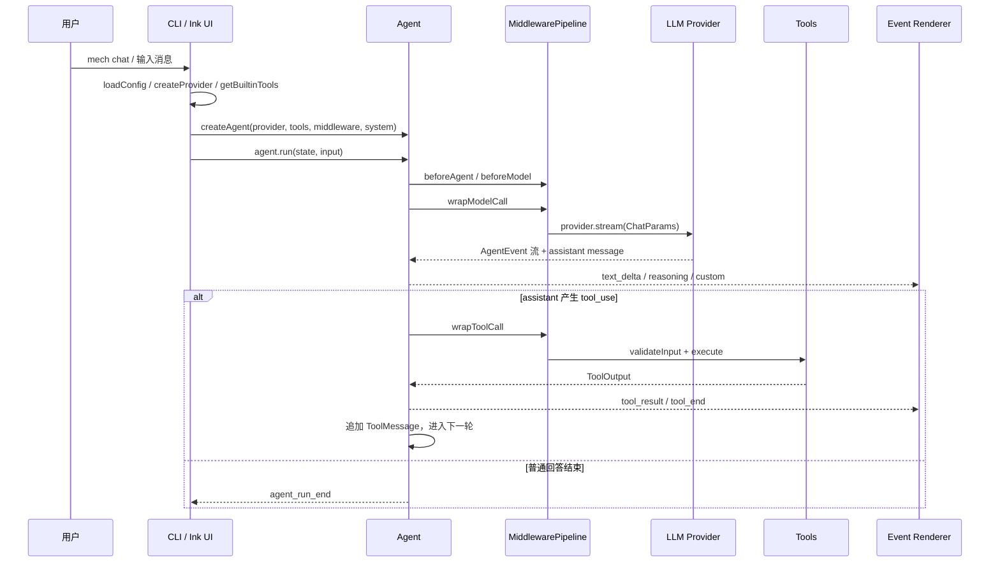

# 当前项目架构图

本文档描述当前仓库的包结构、依赖关系与 Agent 运行时主链路。

## 源码目录

```
packages/
├── shared/src/                 # 跨包协议类型与通用函数
├── core/
│   ├── examples/               # SDK 使用示例
│   └── src/
│       ├── agent/              # Agent 外观、循环、状态与 HITL
│       ├── events/             # AgentEvent 事件流
│       ├── mcp/                # MCP 客户端
│       ├── message/            # 消息处理
│       ├── middleware/         # 中间件协议与管道
│       ├── provider/           # Provider 实现
│       ├── skills/             # Skill 注册
│       └── tools/              # Tool 协议与注册
├── tools/src/                  # read-file、write-file、edit-file、bash
├── middleware/src/             # context-compact、tool-result、todo
└── cli/src/
    ├── adapters/               # 事件渲染适配
    ├── commands/               # CLI 子命令
    ├── config/                 # 配置加载与运行时装配
    ├── prompts/                # 系统提示词
    └── ui/                     # Ink 页面、组件与 hooks
```

测试统一位于相应源码目录下的 `__tests__/*.test.ts`。`dist/`、`node_modules/` 与 `*.tsbuildinfo` 均为生成内容，因此不纳入源码目录。

## 包结构



## 运行时链路



## 模块职责

- `@mech-code/cli`：命令行入口与交互界面，负责加载配置、创建 Provider、组装内置工具和中间件，并通过 React Ink 渲染事件流。
- `@mech-code/core`：Agent 核心框架，包含 Agent 外观、运行循环、消息协议、Provider 抽象、工具协议、中间件管道、MCP 与事件系统。
- `@mech-code/tools`：内置工具包，当前包含 `read-file`、`write-file`、`edit-file` 与 `bash`。
- `@mech-code/middleware`：内置中间件包，当前包含上下文压缩、工具结果管理与 todo 状态能力。
- `@mech-code/shared`：跨包共享类型，包含消息类型、事件类型、用量统计、工具定义、HITL checkpoint 等协议数据结构。

消息在构造 `UserMessage` 或 `AssistantMessage` 时就会形成规范的内容块数组。Agent Loop、中间件和 Provider 共用 `AgentMessage`，Provider serializer 直接完成厂商请求格式转换，不存在额外的内部消息协议。

## 关键入口

- CLI 启动入口：`packages/cli/src/index.ts`
- chat 命令装配：`packages/cli/src/commands/chat.ts`
- Agent 外观：`packages/core/src/agent/agent.ts`
- Agent 主循环：`packages/core/src/agent/loop.ts`
- 中间件管道：`packages/core/src/middleware/pipeline.ts`
- 内置工具导出：`packages/tools/src/index.ts`
- 内置中间件导出：`packages/middleware/src/index.ts`
- 共享协议类型：`packages/shared/src/index.ts`
